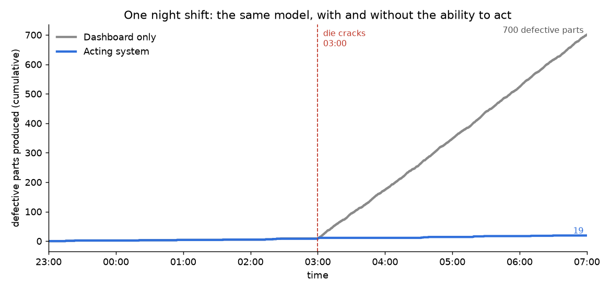
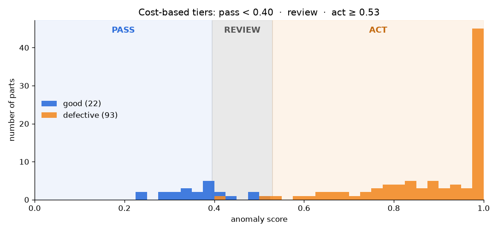
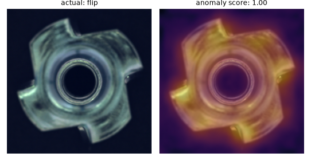
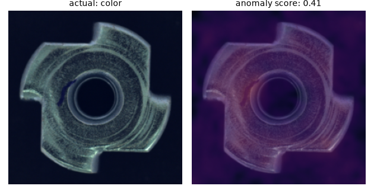
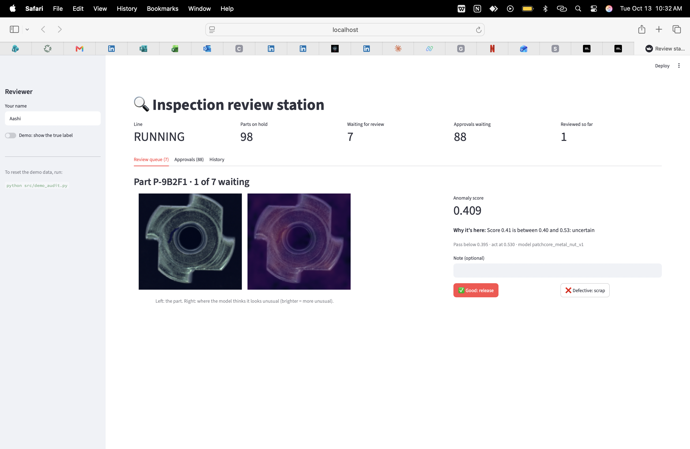

# Acting Inspector

**A computer vision system that doesn't just detect defects: it decides what to do about them.**

Most vision projects end at a bounding box or a score on a dashboard. This one goes further. An anomaly detector scores each part, a cost-based decision layer chooses **PASS, REVIEW or ACT**, and the system then carries out reversible actions on its own, routes uncertain parts to a human, asks for approval before anything irreversible, and logs every step.

Built on the MVTec AD *metal_nut* dataset with PatchCore (anomalib).



> In a simulated night shift where a die cracks at 03:00, the dashboard-only factory produces **700 defective parts** before anyone looks at 07:00. The acting system contains the fault in **75 seconds** and ends the shift with **19**. Same model, same parts.

---

## Headline results

| | Result |
| --- | --- |
| Model quality (image AUROC) | **0.997** |
| Expected cost vs anomalib's default threshold | **90% lower** (€1,157 vs €11,060 per 1,000 parts) |
| Test set, 115 parts: wrong automatic decisions | **0** (no defect passed, no good part stopped the line) |
| Night shift with a 03:00 die crack: fault contained | **75 seconds** vs 4 hours |
| Defects shipped to customers (one shift) | **0** vs 11 |
| Average cost over 50 simulated shifts | **95% lower** |

All costs are **illustrative assumptions** (see `src/config.py` and the top of `src/simulate_shift.py`). The point is the method, not the euros.

---

## How it works

```
camera image
    │
    ▼
PatchCore anomaly model ──► score (0–1) + heatmap
    │
    ▼
Decision layer (cost-based tiers)
    ├─ score < 0.395   PASS     part continues
    ├─ 0.395 – 0.530   REVIEW   hold part, send to a human
    └─ score ≥ 0.530   ACT      pause line 30 s, hold part, open ticket, alert phone
                                 quarantine batch → needs human approval
    │
    ▼
Audit trail (SQLite, append-only): every decision, action and human input
    │
    ▼
Review station (Streamlit) ──► verdicts ──► feedback loop ──► proposed thresholds
                                                             (applied only with approval)
```

### Five design principles

1. **Confidence tiers, not one threshold.** Two thresholds create PASS / REVIEW / ACT, chosen by what mistakes cost, not by accuracy.
2. **Automate the reversible, keep humans on the irreversible.** Pausing the line or holding a part runs automatically. Quarantining a batch or changing thresholds always needs a named person. The code asserts this.
3. **Design escalation up front.** One ACT pauses the line for 30 seconds. Three ACTs in 10 minutes stops it and calls an engineer.
4. **Keep a complete audit trail.** Decisions are logged *before* actions run. The log is append-only, and failed actions (such as an undelivered alert) are recorded as failures.
5. **Learn from humans, but measure them first.** Reviewer verdicts are checked against known answers before they're allowed to influence thresholds.

---

## What I found

### 1. A 0.997 AUROC model can still be expensive



With anomalib's default threshold (0.5), the model misclassifies only 2 of 115 test parts. But at realistic factory proportions (2% defects), that single false alarm means 45 needless line stops per 1,000 parts.

| Policy | Cost per 1,000 parts |
| --- | --- |
| Default threshold (0.5) | €11,060 |
| Best single threshold | €4,301 |
| Human reviews everything | €8,000 |
| **Three cost-based tiers** | **€1,157** |

### 2. Some parts can't be separated by any threshold

`good_005` scored **0.408857**. `color_004`, a real defect, scored **0.408904**. They differ by 0.00005. No threshold can split them, which is exactly why a review tier exists.

<p>
  
  
</p>

*Left: a flipped nut (score 1.00). The whole part glows. Right: a small colour mark (score 0.41). The model looked in the right place but wasn't sure.*

### 3. The acting system produced more good parts, not fewer

In the night-shift simulation, the acting line stopped for 84 minutes in total and made fewer parts overall (1,583 vs 1,920). But it made **1,564 good parts vs 1,220**, because it wasn't spending four hours producing scrap.

| One night shift | Dashboard only | Acting system |
| --- | --- | --- |
| Fault contained | 07:00 | **03:01** |
| Defective parts produced | 700 | **19** |
| Defects shipped | 11 | **0** |
| Good parts produced | 1,220 | **1,564** |
| Total cost | €123,305 | **€6,502** |

### 4. What went wrong (and is worth knowing)

- **False escalations.** The "3 ACTs in 10 minutes" rule called an engineer out **three times for nothing** in one night, accounting for 60 of the 84 minutes of downtime. Escalation rules need tuning just like thresholds.
- **The review bottleneck.** About a quarter of good parts fall in the review band: **558 reviews per shift against a capacity of about 240**. The parts are safely held, but no factory would accept that queue.
- **The human in the loop was a coin flip.** I reviewed the 8 hardest parts myself in the review station: **4 of 8 correct (50%)**, median 4 seconds per part. I scrapped three good parts, released one defect, and wrongly overrode one correct ACT decision. The cost model had assumed 98% reviewer accuracy.
- **The feedback loop proposed a bad change, and the approval gate stopped it.** With measured human accuracy, expected cost rises from €1,157 to €2,080 per 1,000 parts. The "max 0.05 change per update" guardrail clamped the proposal halfway, producing thresholds worse than both the current and the target ones. I rejected it at the approval step. **Lesson: a guardrail must re-check the result, not just limit the size of the change.**



---

## Run it yourself

Requires Python 3.10–3.12. Tested on an Apple Silicon Mac (CPU only).

```bash
git clone https://github.com/<your-username>/acting-inspector.git
cd acting-inspector
python3 -m venv .venv && source .venv/bin/activate
pip install -r requirements.txt
```

Download MVTec AD from the [MVTec website](https://www.mvtec.com/company/research/datasets/mvtec-ad) and extract it so that `data/MVTecAD/metal_nut/` exists. Then:

| Step | Command | What it does |
| --- | --- | --- |
| 1 | `python src/explore_data.py` | Counts images, saves a defect overview |
| 2 | `python src/train.py` | Trains PatchCore (~7 min on CPU) |
| 3 | `python src/score_test_set.py` | Scores all 115 test parts, saves heatmaps |
| 4 | `python src/tune_thresholds.py` | Chooses cost-based tiers |
| 5 | `python src/test_decisions.py` | Checks the decision layer and guardrails |
| 6 | `python src/demo_actions.py` | Runs PASS / REVIEW / ACT with real actions |
| 7 | `python src/demo_audit.py` | Processes all parts with a full audit trail |
| 8 | `python src/simulate_shift.py` | Simulates a night shift, 50 shifts in total |
| 9 | `streamlit run app/review_app.py` | Opens the human review station |
| 10 | `python src/feedback_loop.py` | Measures reviewers and proposes new thresholds |

Phone alerts use [ntfy](https://ntfy.sh). Set your own private topic in `src/config.py`.

## Limitations

- **Thresholds were tuned on the same 115 test images they're evaluated on**, so the results are optimistic. A real deployment would tune on a separate validation set.
- **Only 22 good test images.** Each borderline good part represents about 4.5% of good production.
- **All costs and shift parameters are illustrative.** Change them in the config and the conclusions can shift.
- **The simulation is simplified:** one line, one fault type.
- **8 human verdicts is a very small sample.**
- **Quarantine requests aren't grouped by batch.**
- **MVTec AD is licensed CC BY-NC-SA 4.0**: non-commercial use only.

## Next steps

- **Better reviews, not just fewer:** larger images, a known-good reference part side by side, or physical inspection.
- **A better model to shrink the grey zone:** more normal training images or a stronger backbone.
- **Smarter escalation:** a defect *rate* over a rolling window instead of a fixed count.
- **A guardrail that only proposes changes that beat the status quo.**
- **Group quarantine requests by batch.**

---

*Built step by step as a hands-on companion to my article "Beyond the Bounding Box: When Computer Vision Starts to Act".*
